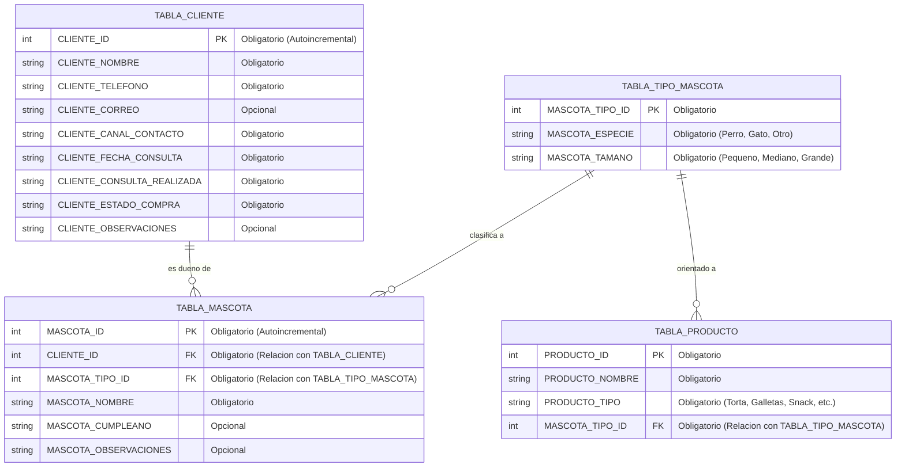

## Modelo de Base de Datos — Peluditos Pet Chile (Entrega 2)

### Detalle de Tablas y Campos
#### 1. `TABLA_CLIENTE`
| Dato | Tipo sugerido | Obligatoriedad | Rol / Clave |
| :--- | :--- | :--- | :--- |
| `CLIENTE_ID` | `INTEGER` | Obligatorio | Primary Key (PK) |
| `CLIENTE_NOMBRE` | `TEXT` | Obligatorio | Nombre del potencial cliente |
| `CLIENTE_TELEFONO` | `TEXT` | Obligatorio | Teléfono o WhatsApp |
| `CLIENTE_CORREO` | `TEXT` | Opcional | Correo electrónico |
| `CLIENTE_CANAL_CONTACTO` | `TEXT` | Obligatorio | WhatsApp, Instagram, Facebook, TikTok u otro |
| `CLIENTE_FECHA_CONSULTA` | `TEXT` | Obligatorio | Fecha del primer contacto |
| `CLIENTE_CONSULTA_REALIZADA` | `TEXT` | Obligatorio | Producto o información consultada |
| `CLIENTE_ESTADO_COMPRA` | `TEXT` | Obligatorio | Pendiente / Compra realizada / Sin compra |
| `CLIENTE_OBSERVACIONES` | `TEXT` | Opcional | Notas del seguimiento comercial |
#### 2. `TABLA_MASCOTA`
| Dato | Tipo sugerido | Obligatoriedad | Rol / Clave |
| :--- | :--- | :--- | :--- |
| `MASCOTA_ID` | `INTEGER` | Obligatorio | Primary Key (PK) |
| `CLIENTE_ID` | `INTEGER` | Obligatorio | Foreign Key (FK → `TABLA_CLIENTE`) |
| `MASCOTA_TIPO_ID` | `INTEGER` | Obligatorio | Foreign Key (FK → `TABLA_TIPO_MASCOTA`) |
| `MASCOTA_NOMBRE` | `TEXT` | Obligatorio | Nombre de la mascota |
| `MASCOTA_CUMPLEANO` | `TEXT` | Opcional | Fecha de cumpleaños para campañas |
| `MASCOTA_OBSERVACIONES` | `TEXT` | Opcional | Alergias, preferencias o notas |
#### 3. `TABLA_TIPO_MASCOTA`
| Dato | Tipo sugerido | Obligatoriedad | Rol / Clave |
| :--- | :--- | :--- | :--- |
| `MASCOTA_TIPO_ID` | `INTEGER` | Obligatorio | Primary Key (PK) |
| `MASCOTA_ESPECIE` | `TEXT` | Obligatorio | Perro, Gato u otro |
| `MASCOTA_TAMANO` | `TEXT` | Obligatorio | Pequeño, Mediano, Grande |
#### 4. `TABLA_PRODUCTO`
| Dato | Tipo sugerido | Obligatoriedad | Rol / Clave |
| :--- | :--- | :--- | :--- |
| `PRODUCTO_ID` | `INTEGER` | Obligatorio | Primary Key (PK) |
| `PRODUCTO_NOMBRE` | `TEXT` | Obligatorio | Nombre del producto |
| `PRODUCTO_TIPO` | `TEXT` | Obligatorio | Categoría (Pastelería, Snack, etc.) |
| `MASCOTA_TIPO_ID` | `INTEGER` | Obligatorio | Foreign Key (FK → `TABLA_TIPO_MASCOTA`) |
| `PRODUCTO_NOMBRE` | `TEXT` | Obligatorio | Nombre del producto |
| `PRODUCTO_TIPO` | `TEXT` | Obligatorio | Categoría (Pastelería, Snack, etc.) |
| `MASCOTA_TIPO_ID` | `INTEGER` | Obligatorio | Foreign Key (FK → `TABLA_TIPO_MASCOTA`) |
