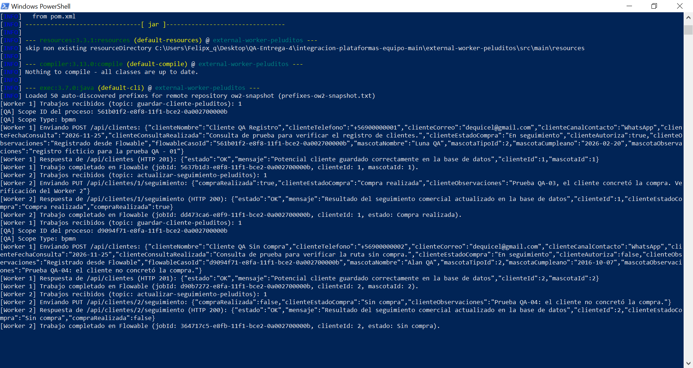
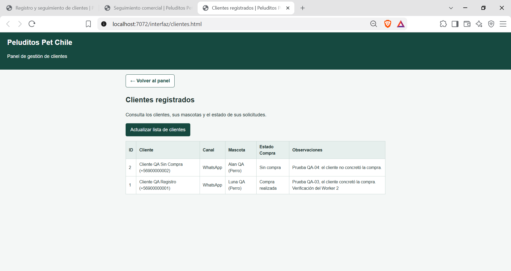
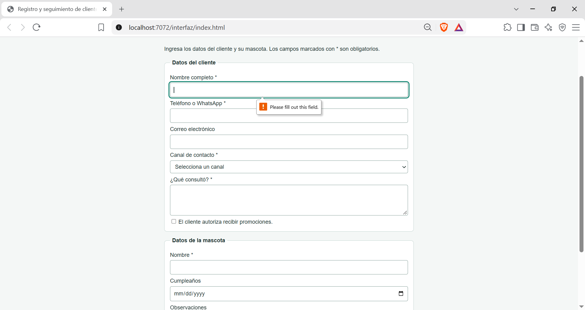
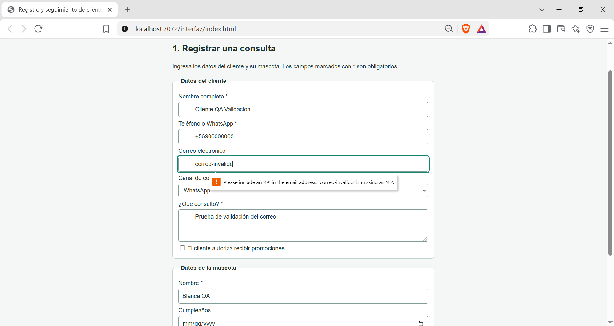
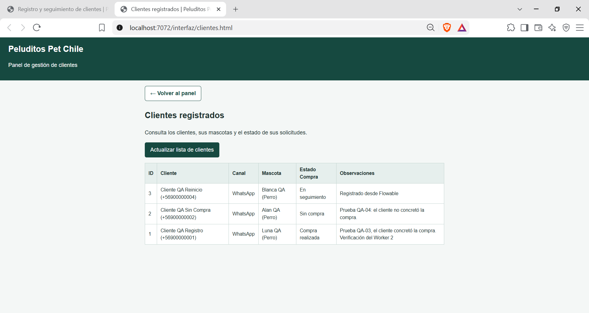
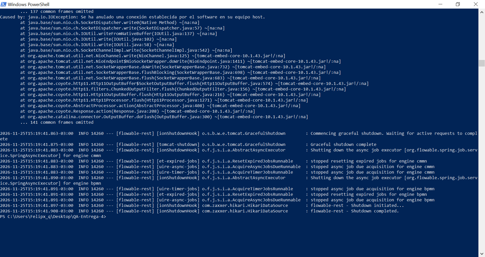
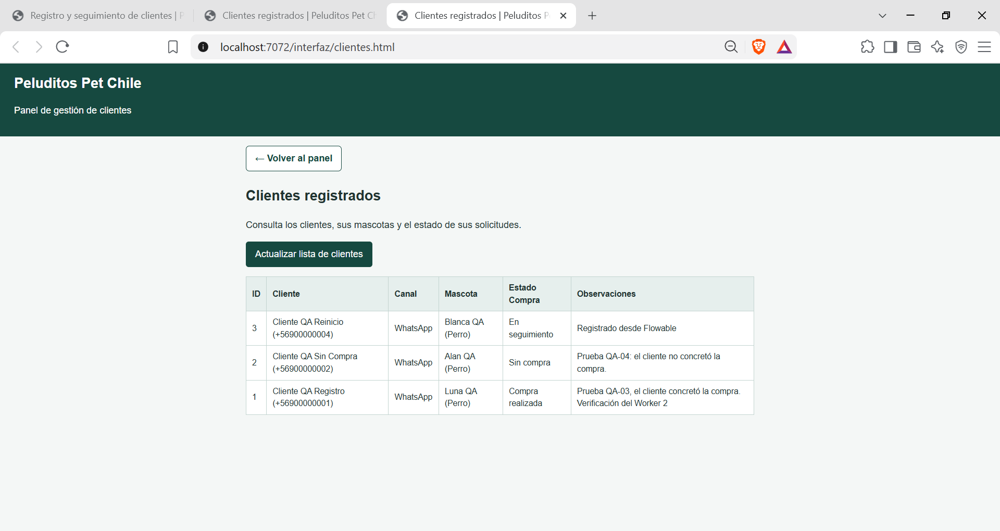
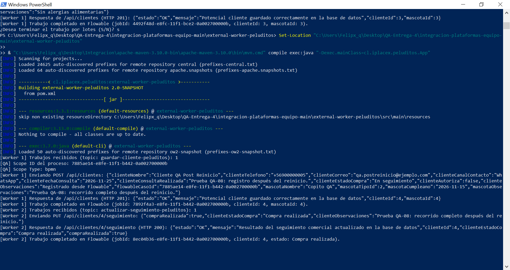
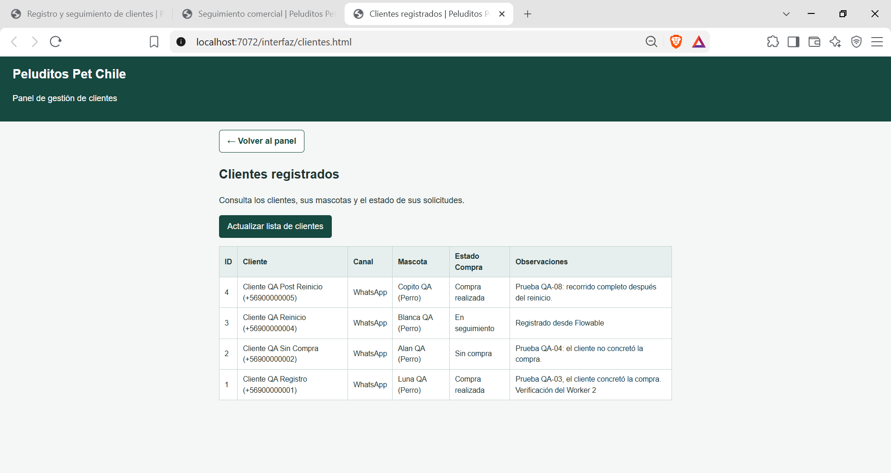

# Informe de pruebas QA - Avance de Entrega 4

**Proyecto:** Peluditos Pet Chile  
**Responsable:** Felipe Quicel  
**Fecha:** 25 de noviembre de 2026  
**Estado:** 8 pruebas aprobadas y QA-09 pendiente.

## Versión y entorno

Probé la copia de main identificada con el commit `cdad1af71e0e0382661e1e8ab9478492c9e0b830`, obtenido del ZIP descargado. La documentación de esa copia corresponde a la Entrega 3. Este informe registra el avance de QA para el examen; si se incorporan cambios, habrá que repetir las pruebas afectadas.

Las pruebas se realizaron en Windows, con PowerShell, Brave, Microsoft OpenJDK 21.0.12, Maven 3.10.0 y Flowable OSS 7.2.0. Flowable funcionó en el puerto 8080 y el servicio Jakarta REST en el 7072. Se utilizaron SQLite para los datos del negocio y H2 persistente para el motor.

## Resumen de resultados

| Código | Prueba realizada | Resultado |
| --- | --- | --- |
| QA-01 | Registrar un cliente desde la interfaz y comprobar el guardado mediante el Worker 1. | Aprobada: HTTP 201 y tarea completada en Flowable, después de resolver la incidencia de consola. |
| QA-02 | Consultar los clientes y sus mascotas en el listado. | Aprobada: se recuperaron los datos visibles ingresados. |
| QA-03 | Completar el seguimiento indicando que hubo compra. | Aprobada: el Worker 2 obtuvo HTTP 200, el estado quedó en Compra realizada y el proceso terminó en Venta concretada. |
| QA-04 | Completar el seguimiento indicando que no hubo compra. | Aprobada: el Worker 2 obtuvo HTTP 200, el estado quedó en Sin compra y el proceso terminó en Venta no concretada de potencial cliente. |
| QA-05 | Intentar avanzar con el formulario vacío. | Aprobada: el navegador solicitó el nombre obligatorio e impidió avanzar. No se creó otro registro. |
| QA-06 | Ingresar un correo sin arroba e intentar revisar los datos. | Aprobada: el navegador indicó el formato incorrecto e impidió avanzar. No se creó otro registro. |
| QA-07 | Detener y volver a iniciar los componentes usando las mismas bases. | Aprobada: se conservaron los tres clientes, sus estados, la instancia y tarea pendientes y los dos historiales finalizados. |
| QA-08 | Registrar un cliente nuevo y completar su seguimiento después del reinicio. | Aprobada: ambos workers procesaron el recorrido y el nuevo cliente quedó en Compra realizada. |
| QA-09 | Instalar y verificar la solución en otro equipo o entorno de destino. | Pendiente de coordinar y ejecutar. |

## Evidencias

### Registro y seguimiento: QA-01 a QA-04

Registré a Cliente QA Registro con Luna QA y a Cliente QA Sin Compra con Alan QA. El primer seguimiento se completó con compra y el segundo sin compra. Los workers registraron respuestas HTTP 201 para el guardado y HTTP 200 para las actualizaciones, y completaron sus trabajos en Flowable. También se consultó el historial para comprobar los finales de los procesos.

**Procesamiento de los dos caminos:**

**Consulta de los clientes con sus estados finales:**

### Validaciones: QA-05 y QA-06

Con el formulario vacío, el navegador solicitó completar Nombre completo. Al ingresar `correo-invalido`, indicó que faltaba `@`. En ambos casos impidió avanzar. Las consultas posteriores mantuvieron los dos clientes anteriores y cero procesos activos nuevos.

Estas pruebas corresponden a las validaciones del navegador. No prueban cada campo obligatorio por separado ni el rechazo de esos datos al enviar solicitudes directamente al servicio REST.

**Campo obligatorio vacío:**

**Correo con formato incorrecto:**

### Persistencia: QA-07

Antes del reinicio registré a Cliente QA Reinicio con Blanca QA y lo dejé En seguimiento. Así quedaron dos clientes con su seguimiento finalizado y uno pendiente.

Detuve los workers, después Jakarta REST y finalmente Flowable. Se comprobó que los puertos 7072 y 8080 dejaran de aceptar conexiones. Luego inicié los componentes usando las mismas bases: `Datos/peluditos-qa.db` y `Datos/flowable-qa.mv.db`.

Después del reinicio se recuperaron los tres clientes con los mismos campos comparados y estados. Las consultas a Flowable conservaron la misma instancia y tarea pendientes y los dos historiales finalizados. Las capturas de antes y después corresponden a momentos distintos de la prueba.

**Tres clientes antes del reinicio:**

**Apagado completado de Flowable:**

**Los mismos clientes después del reinicio:**

### Recorrido posterior al reinicio: QA-08

Con los componentes nuevamente iniciados, registré a Cliente QA Post Reinicio con Copito QA. El Worker 1 creó el cliente ID 4 con HTTP 201. Después completé su seguimiento con compra y el Worker 2 obtuvo HTTP 200. El historial confirmó el final Venta concretada y el listado mostró el nuevo cliente en Compra realizada.

**Registro y seguimiento procesados después del reinicio:**

**Listado final con los cuatro clientes:**

## Incidencia observada

Durante QA-01, el worker quedó esperando una respuesta de Flowable mientras la consola del motor estaba bloqueada al escribir. Después de pulsar Esc para salir del modo de selección, el mismo trabajo se procesó correctamente. No fue necesario modificar código ni repetir el registro. La incidencia quedó resuelta durante la prueba.

## Pendientes

Falta ejecutar QA-09 siguiendo la guía de instalación en otro equipo o entorno de destino. El reinicio realizado en este computador no reemplaza esa comprobación.

Las ocho pruebas realizadas funcionaron dentro del alcance descrito. Este informe se actualizará con QA-09 y con las pruebas de los cambios que el equipo incorpore para la versión final.
